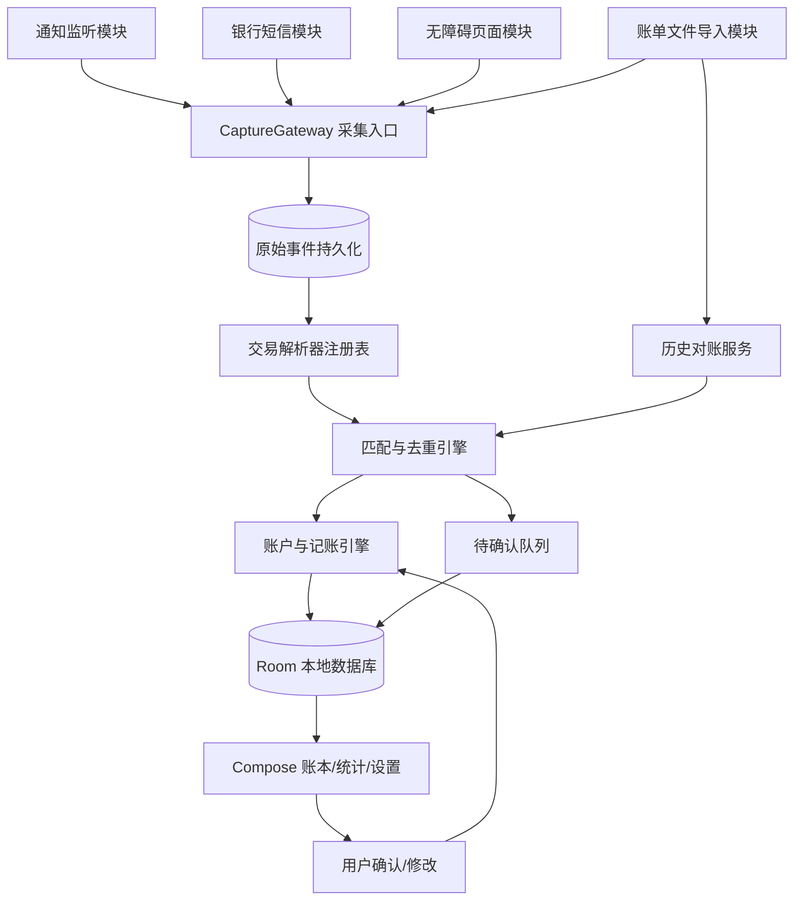
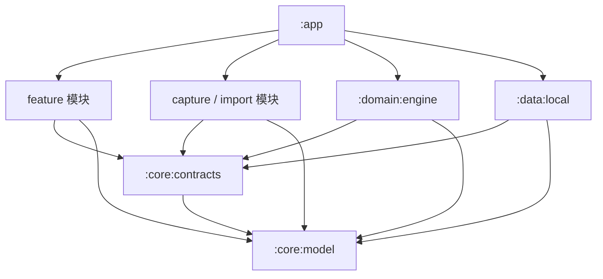

# OctopusCue Android 自动记账 App — 架构与模块设计文档

> 文档版本：v1.0（初始设计）  
> 技术方向：Android / Kotlin / Jetpack Compose / Room  
> 应用场景：个人使用、单设备优先、离线优先  
> 架构：模块化单体（Modular Monolith）＋ Ports & Adapters（端口与适配器）＋事件驱动流水线

## 1. 项目概述

### 1.1 项目目标

OctopusCue 是一款以“尽可能自动记账、记录准确、隐私可控”为核心的 Android 个人记账应用。它通过多渠道采集**交易证据**，识别真实交易并归并到同一本账簿。

首期目标：

1. 采集微信、支付宝及指定银行 App 的交易系统通知。
2. 将通知解析为金额、收支方向、时间、商户及资金账户等结构化信息。
3. 合并同一交易的不同采集证据，避免重复记账。
4. 支持微信、支付宝历史账单导入，以补全漏记并核对交易。
5. 支持手动编辑、待确认、收支统计与本地数据导出。
6. 后续通过独立模块接入银行短信及支付结果页面采集，无需重写账本核心。

### 1.2 非目标

- 不实现微信、支付宝个人账户的非公开接口登录、抓包同步或绕过认证。
- 不自动发起付款、转账、登录，也不读取支付密码或短信验证码。
- 第一阶段不做用户注册、服务器、云同步、多人共享账本、iOS 客户端。
- 不保证每笔微信/支付宝收款均能实时采集：是否可读取取决于通知内容、页面是否实际可访问和用户授权。

### 1.3 核心原则

- **本地优先**：业务数据默认留在设备上；第一版不依赖后端。
- **证据与交易分离**：通知、短信、页面和文件都是交易的观察证据，不等同于最终账目。
- **采集与入账分离**：任何采集模块都不能直接插入正式交易。
- **模块单向依赖**：上层通过接口依赖下层抽象，禁止跨模块直接调用 DAO。
- **幂等**：相同事件重复投递、相同文件重复导入，不得重复入账。
- **保守匹配**：证据不足时转待确认，不因时间接近或金额相同就直接合并。
- **可追溯**：正式交易可以追溯至原始事件、解析结果和人工修改。

## 2. 技术选型

| 领域 | 选型 | 说明 |
| --- | --- | --- |
| 语言 | Kotlin | 主开发语言；业务核心尽量纯 Kotlin |
| Android 最低版本 | API 26（Android 8.0） | 首期设备兼容基线；`targetSdk` 与 `compileSdk` 以可用工具链为准 |
| UI | Jetpack Compose + Material 3 | 声明式界面 |
| 架构 | MVVM（UI）＋用例/领域服务（业务） | ViewModel 不承载解析和去重规则 |
| 本地存储 | Room / SQLite | 交易、账户、采集事件、关联与导入批次 |
| 配置 | DataStore | 采集开关、自动入账策略和偏好 |
| 异步 | Coroutines + Flow | 非阻塞处理、订阅数据库变更 |
| 补偿任务 | WorkManager | 已持久化但未处理事件的补偿；不是实时采集替代品 |
| 依赖注入 | 初期手动组装，按需迁移 Hilt | 降低个人项目初期复杂度 |
| 测试 | JUnit + Kotlin 单元测试；Android 仪器测试 | 规则测试、DAO 测试、真机权限/生命周期测试 |
| 构建 | Gradle Kotlin DSL | 独立模块，每个模块有自己的 `build.gradle.kts` |

IDE 可使用 IntelliJ IDEA（具备兼容的 Android 插件和 SDK）或 Android Studio。**模块划分与 IDE 无关**。

## 3. 系统架构总览



流程中的 `CaptureGateway` 负责**接收并可靠保存采集事件**，不意味着提交成功就已入账；解析和匹配可以随后异步执行。

### 3.1 三层职责

1. **适配层（Adapters）**：负责 Android 通知、短信、无障碍页面、账单文件以及界面。
2. **领域层（Domain）**：负责解析结果、交易身份、匹配、账户变化、分类与对账规则。
3. **持久化层（Persistence）**：负责 Room 表、DAO、事务、索引、迁移及 Repository 实现。

### 3.2 交易事实模型

系统维护三种不同对象，不能混淆：

- **CaptureEvent（原始采集事件）**：某时刻从某渠道观察到的一段原文、页面节点或账单记录。
- **TransactionObservation（结构化交易观察）**：解析器认为事件表示可能发生了一笔金额为 X 的收款/付款/退款，带来源、置信度、状态与证据。
- **Transaction（真实账本交易）**：经过匹配与记账策略确认的一笔真实资金活动，可由多个观察共同支持。

## 4. Gradle 模块划分

目标架构包含 **12 个模块**；第一阶段先完成其中 9 个。模块内可以有多个 Kotlin `package`，不需要把每个解析器都拆成一个 Gradle 模块。

| 模块 | 类型 | 核心职责 | 阶段 |
| --- | --- | --- | --- |
| `:app` | Android Application | App 入口、根导航、依赖组装与生命周期初始化 | MVP |
| `:core:model` | Kotlin JVM | 公共不可变模型、枚举、金额与时间类型 | MVP |
| `:core:contracts` | Kotlin JVM | CaptureGateway、Repository、用例和配置接口 | MVP |
| `:data:local` | Android Library | Room、DAO、实体映射、Repository 实现、DataStore | MVP |
| `:domain:engine` | Kotlin JVM | 交易解析、匹配、去重、分类、入账、对账、确认 | MVP |
| `:capture:notification` | Android Library | NotificationListenerService、白名单与通知快照 | MVP |
| `:import:bill` | Android Library | 系统文件选择/读取、CSV/XLSX/ZIP 导入适配器 | MVP |
| `:feature:ledger` | Android Library | 首页、明细、账户、统计、待确认与编辑页面 | MVP |
| `:feature:settings` | Android Library | 权限引导、来源开关、规则与账户设置 | MVP |
| `:capture:sms` | Android Library | 新到银行短信接收与基本来源过滤 | 扩展 |
| `:capture:accessibility` | Android Library | 页面事件采集、节点快照、应用白名单 | 扩展 |
| `:feature:debug` | Android Library | 采集诊断、规则命中、去重决策与脱敏样本回放 | 扩展 |

### 4.1 `:app` — 应用组装模块

**负责**：`Application`、`MainActivity`、Compose 根导航、初始化依赖、将抽象接口绑定到具体实现、全局异常处理。

**不负责**：微信正则、银行短信解析、SQL、业务去重等。

**关键设计**：Android Service 是由系统启动的组件。初期可由 Application 通过 `AppGraph` 提供其所需 `CaptureGateway`；组件只依赖 `:core:contracts` 声明的接口，不直接拿数据库 DAO。

### 4.2 `:core:model` — 公共模型模块

**负责**：`CaptureEvent`、`CaptureSource`、`TransactionObservation`、`Transaction`、`Account`、`Money`、交易状态、方向及来源关联模型。

**约束**：不使用 Android Context、Room Annotation 或 Compose 类；金额以最小货币单位保存，人民币使用 `Long` 分值。

### 4.3 `:core:contracts` — 端口接口模块

**负责**：定义 `CaptureGateway`、`CaptureEventRepository`、`TransactionRepository`、`AccountRepository`、`LedgerWriter`、`ProcessingScheduler`、`SettingsRepository` 等接口。

**约束**：接口入参与返回值使用 `core:model` 类型；不暴露 Room DAO、SQLite Cursor、Android Service 等实现细节。

### 4.4 `:capture:notification` — 通知采集

**负责**：

- `NotificationListenerService` 监听用户授权的系统通知。
- 通过包名和用户配置过滤微信、支付宝和银行 App 通知。
- 提取标题、正文、展开文字、分行文本、通知实例 Key、通知时间。
- 处理折叠摘要、同一通知更新和采集服务断开重连。
- 将事件提交给 `CaptureGateway`；不决定交易是否成立。

**边界**：只能读取 Android 实际向监听服务提供的系统通知，不能读取微信、支付宝内部数据库。不要持久化无关聊天内容或验证码。

### 4.5 `:capture:sms` — 银行短信采集

**负责**：`SMS_RECEIVED` 广播、新到短信分段组装、发送方及银行签名初筛、提交标准采集事件。

**边界**：默认关闭；短信权限在 Android 和分发环境中可能被限制。只申请确有必要的 `RECEIVE_SMS`，不将“可安装 APK”视作必然可获短信权限。无法使用时，降级为银行 App / 短信 App 系统通知采集。

### 4.6 `:capture:accessibility` — 支付页面采集

**负责**：

- 用户授权后接收窗口状态变化、内容变化、窗口集合变化事件。
- 限定用户选择的应用包名，读取当前可访问页面节点。
- 对高频事件防抖、页面多次采样，并输出结构化 `PageSnapshot`。
- 将微信、支付宝等页面证据通过统一采集入口提交。

**边界**：不自动点击、不执行支付、不截取密码、不假装系统无障碍组件、不保证未打开的微信收款页面可被读取。页面语义解析放在 `:domain:engine/parser`。

### 4.7 `:import:bill` — 历史账单导入

**负责**：用户通过系统文件选择器导入 CSV/XLSX/ZIP 文件；识别来源格式、表头、编码与日期；输出按行可追踪的标准化采集事件。

**适配器**：`WeChatBillAdapter`、`AlipayBillAdapter`、`BankBillAdapter`。每个来源可以独立扩展。

**边界**：不自动登录支付平台请求账单；不绕过统一匹配引擎直接写 `transactions`。

### 4.8 `:domain:engine` — 业务核心

建议先在一个 Gradle 模块内组织七个子包：

| 子包 | 职责 |
| --- | --- |
| `ingestion` | 事件合法性检查、标准化、处理任务登记与状态流转 |
| `parser` | 按来源分派解析器；提取金额、方向、状态、时间、商户等 |
| `matching` | 去重、交易身份关联、跨来源证据匹配、冲突决策 |
| `accounting` | 账户变动、收入/支出/转账/退款和记账一致性 |
| `categorization` | 商户规则和分类建议、人工修改偏好 |
| `reconciliation` | 历史账单与实时交易对账、漏记补全、退款关联 |
| `review` | 待确认状态、用户确认/忽略/修改及重新处理 |

**必须坚持**：规则解析器只产生观察记录；匹配器决定“是不是同一笔”；记账引擎决定“如何影响账户”。

### 4.9 `:data:local` — 本地数据实现

**负责**：Room Database、Entities、DAOs、迁移、事务、Repository 实现；DataStore 中的采集设置。支持原始证据查询、待处理任务恢复和操作追溯。

**边界**：不包含微信业务正则、不直接操作 UI。不向采集模块暴露 DAO。

### 4.10 `:feature:ledger` — 账本与统计 UI

**负责**：首页总览、交易明细、筛选、账户管理、分类统计、交易详情与编辑、待确认列表、手动记账。

**约束**：Compose + ViewModel + `StateFlow`，通过业务接口获得数据、提交命令，不直接写 SQL。

### 4.11 `:feature:settings` — 设置和权限引导

**负责**：通知监听授权检查、银行短信开关、无障碍服务开关、来源白名单、自动入账策略、本地备份、安全和隐私配置。

**边界**：显示授权状态和跳转系统授权页，不实现实际事件监听。

### 4.12 `:feature:debug` — 诊断模块

**负责**：查看采集来源与事件处理轨迹；展示“未匹配原因”；使用脱敏固定样本回放解析器；统计事件捕获、识别和去重结果。

**安全要求**：调试日志默认不留全量通知原文；可设置短期调试模式、敏感信息遮罩和定期清理。

## 5. 模块依赖规范

下方箭头表示**编译依赖**，并非业务数据方向：



**禁止**：

- `capture:*` 直接依赖 `data:local`、`domain:engine` 或 `feature:*`。
- `domain:engine` 依赖 `android.*`、Room、Compose 或具体采集服务。
- `data:local` 依赖 `domain:engine` 实现。
- `feature:*` 直接访问 DAO 或直接创建通知服务。
- 两个功能模块互相依赖形成环。

**组装方式**：由 `:app` 建立 `AppGraph`，用 `data:local` 的仓库实现注入 `domain:engine`，再将引擎提供的 `CaptureGateway` 注入采集模块的服务运行环境。后续若引入 Hilt，保留接口不变。

## 6. 统一事件模型与接口

### 6.1 采集事件（示例）

```kotlin
data class CaptureEvent(
    val id: String,
    val source: CaptureSource,
    val sourceInstanceKey: String?,
    val capturedAtMillis: Long,
    val sourceOccurredAtMillis: Long?,
    val payload: CapturePayload
)

sealed interface CapturePayload {
    data class NotificationText(val packageName: String, val title: String, val body: String) : CapturePayload
    data class SmsText(val sender: String, val body: String) : CapturePayload
    data class PageSnapshot(val packageName: String, val lines: List<String>) : CapturePayload
    data class BillRow(val provider: String, val columns: Map<String, String>) : CapturePayload
}
```

这里是**逻辑模型**。正式实现中应限制 payload 大小；页面节点元数据可扩展；敏感字段入库前遵守最小化和脱敏策略。

### 6.2 端口接口

```kotlin
interface CaptureGateway {
    /** 返回事件接收/持久化结果，不代表已记账。 */
    suspend fun submit(event: CaptureEvent): CaptureAcceptance
}

interface CaptureEventRepository {
    suspend fun insertIfAbsent(event: CaptureEvent): Boolean
    suspend fun pending(limit: Int): List<CaptureEvent>
    suspend fun updateState(eventId: String, state: EventState)
}

interface TransactionParser {
    fun supports(event: CaptureEvent): Boolean
    fun parse(event: CaptureEvent): ParseResult
}

interface TransactionRepository {
    fun observeTransactions(): kotlinx.coroutines.flow.Flow<List<Transaction>>
    suspend fun findById(id: String): Transaction?
}
```

`ParseResult` 建议区分 `Recognized`、`NeedsReview` 和 `Ignored`；所有解析器使用 `ParserRegistry` 按来源注册。

### 6.3 事件处理状态

```text
RECEIVED → STORED → PARSING → PARSED → MATCHING
                                     ├→ LINKED_EXISTING
                                     ├→ PENDING_REVIEW
                                     └→ POSTED
              └→ RETRYABLE_FAILURE / IGNORED
```

事件状态与交易状态独立：原始事件即便被判定为重复，仍可在证据关联表中指向一笔已存在的交易。

## 7. 数据库设计（MVP）

| 表 | 主要字段 | 目的 |
| --- | --- | --- |
| `capture_events` | `id`, `source`, `instance_key`, `payload`, `captured_at`, `state` | 原始事件及可重试状态 |
| `observations` | `id`, `event_id`, `amount_minor`, `direction`, `occurred_at`, `confidence` | 结构化交易观察 |
| `transactions` | `id`, `kind`, `amount_minor`, `currency`, `occurred_at`, `status`, `merchant`, `category_id` | 真实账本交易 |
| `event_links` | `event_id`, `transaction_id`, `match_reason` | 多事件归并到一笔交易 |
| `accounts` | `id`, `type`, `name`, `masked_number`, `currency` | 微信零钱、支付宝余额、银行卡、信用卡等 |
| `account_movements` | `id`, `transaction_id`, `account_id`, `signed_amount_minor` | 账户资金实际变动 |
| `categories` | `id`, `name`, `parent_id` | 分类统计 |
| `import_batches` | `id`, `source`, `file_hash`, `created_at`, `state` | 文件导入去重与追踪 |
| `review_items` | `id`, `observation_id`, `reason`, `status` | 人工确认队列 |

约束与索引：

- `capture_events(source, instance_key)` 在实例键稳定的来源上建立唯一约束；文件导入另使用“来源 + 文件指纹 + 行号或来源交易号”。
- `event_links(event_id, transaction_id)` 唯一；`transactions` 不用金额+分钟作为唯一键。
- 交易创建、账户变动、证据关联在一个 Room 事务中提交。
- 数据库迁移采用明确的 schema version 与自动化迁移测试。

### 7.1 记账类型和账户处理

- **EXPENSE（消费）**：资产账户减少，费用增加。
- **INCOME（收入）**：资产账户增加，收入增加。
- **TRANSFER（内部转账）**：一个账户减少、另一个增加，净收入/消费均为零。
- **REFUND（退款）**：记录独立的资金流入，并关联原消费以冲减净消费；不得和普通收入混淆。

微信和支付宝是**支付渠道**，微信零钱和支付宝余额是**资金账户**，绑定银行卡又是另一个资金账户。模型需要分别表达 `paymentChannel` 与 `fundingAccountId`，避免把“微信使用银行卡付款”记成两次支出。

## 8. 微信收款专项设计

### 8.1 二维码收款

1. `capture:notification` 监听 `com.tencent.mm` 的系统通知。
2. `domain:engine/parser` 先进行微信支付通知身份验证，再判断“收款到账/已收款/收款金额”等**已通过真实样本验证**的状态语义。
3. 识别金额、时间和可用的对方信息，生成 `INFLOW` 观察。
4. `matching` 检查是否已有相同通知实例或对应收款页面事件。
5. 资金账户能确定时按用户设置自动记账；账户、交易性质或金额不明确时进入待确认。

**边界**：若微信未向 Android 系统发布包含金额的通知，本通道无法知晓该收款。

### 8.2 好友转账

“收到转账邀请/消息”不等于已经领取到账。仅在通知或当前结果页提供足够证据时记为到账，否则转待确认或通过历史账单核实。

### 8.3 红包

红包消息未必包含实际领取金额，禁止凭“收到红包”直接入账。优先以历史账单补全；若有可用的页面证据，也只生成需要用户确认的候选。

### 8.4 页面采集补充

用户打开交易结果或收款详情时，可在权限允许的范围内读取当前可访问节点。识别时需验证**结果页锚点、金额邻域、交易状态、交易时间或订单号**，避免把聊天历史里的“已收款”误判为新的到账。

## 9. 匹配与去重策略

按优先级尝试匹配：

1. **精确交易号**：同来源交易号或银行参考号一致，优先关联。
2. **同事件身份**：同一通知实例、同一账单文件来源行、同一页面交易流程的重复观察。
3. **多字段强证据**：金额、方向、时间、交易状态、商户、账户末四位、支付渠道综合判断。
4. **模糊候选**：同金额短时间但缺少其他证据，不自动合并；标记为“疑似重复”。

规则：

- 金额不同原则上不合并；退款与原消费建立关联而不是合并成一条。
- 收入与支出不互相合并。
- 微信支付通知 + 银行扣款可能是同一笔消费，但**微信收到零钱 + 银行收到钱**不能仅凭金额和时间自动合并。
- 连续两次同额消费必须保留不同的交易身份。
- 用户已手动确认或修改的金额、分类、账户具有更高权重，自动补全不能随意覆盖。

## 10. 安全、隐私与权限

| 能力 | Android 接口 / 权限 | 默认策略 |
| --- | --- | --- |
| 交易通知 | `NotificationListenerService` / 用户开启通知访问 | MVP 中启用前需用户授权 |
| 银行动账短信 | `SMS_RECEIVED` / `RECEIVE_SMS` | 默认关闭；受系统和分发限制 |
| 当前支付页面 | `AccessibilityService` / 用户手动开启 | 后期可选，只读允许的应用 |
| 文件导入 | `ACTION_OPEN_DOCUMENT` | 用户主动选择，不申请广泛存储权限 |
| 本 App 提醒 | Android 13+ `POST_NOTIFICATIONS` | 有需要时申请 |

- 第一版默认不上传账本，不采集支付密码、验证码、无关聊天。
- 原始通知与页面快照仅保留处理必要字段，提供清理及日志脱敏策略。
- 数据库和备份中的金融信息需要考虑加密：Room 本身不等于磁盘加密；密钥建议使用 Android Keystore 管理。
- 明确检查并配置 Android Auto Backup，避免敏感数据库被无意云备份。
- 网络功能如后续加入更新检查，应与账本数据上传严格分离。
- 不将第三方微信无障碍“特殊组件类名兼容技巧”作为产品架构前提。

## 11. 目录结构

```text
OctopusCue/
├── app/
│   ├── src/main/kotlin/com/example/octopuscue/
│   │   ├── OctopusCueApplication.kt
│   │   ├── MainActivity.kt
│   │   └── di/AppGraph.kt
│   ├── src/main/AndroidManifest.xml
│   ├── src/main/res/
│   └── build.gradle.kts
├── core/
│   ├── model/                 # Kotlin JVM Module
│   └── contracts/             # Kotlin JVM Module
├── domain/
│   └── engine/                # Kotlin JVM Module
├── data/
│   └── local/                 # Android Library Module
├── capture/
│   ├── notification/          # Android Library Module
│   ├── sms/                   # Android Library Module
│   └── accessibility/         # Android Library Module
├── import/
│   └── bill/                  # Android Library Module
├── feature/
│   ├── ledger/                # Android Library Module
│   ├── settings/              # Android Library Module
│   └── debug/                 # Android Library Module
├── gradle/
├── build.gradle.kts
├── settings.gradle.kts
└── gradle.properties
```

根 `settings.gradle.kts` 中的模块注册示例（保留 Android 项目模板原有插件/仓库配置）：

```kotlin
include(":app")
include(":core:model", ":core:contracts")
include(":domain:engine", ":data:local")
include(":capture:notification", ":capture:sms", ":capture:accessibility")
include(":import:bill")
include(":feature:ledger", ":feature:settings", ":feature:debug")
```

模块应具有自己的 `build.gradle.kts`：纯业务/接口模块使用 Kotlin JVM 插件；Service、Room 与 Compose 所在模块使用适当的 Android 插件。Android 插件、Kotlin、Compose Compiler、KSP、Room 版本统一由根工程或 Version Catalog 管理。

## 12. 测试策略与验收标准

### 12.1 单元测试（优先）

- `parser`：真实脱敏通知样本、金额解析、退款、红包、聊天营销误判、支付失败。
- `matching`：同通知重发、跨渠道合并、同分钟两次同额付款、账户线索冲突。
- `accounting`：银行卡微信付款只记一笔消费，银行卡充微信零钱是转账，信用卡还款不是消费，退款冲减原消费。
- `import:bill`：重复导入、编码和列顺序差异、退款、文件缺损、跨批次去重。

### 12.2 集成与真机测试

- 使用 Room 测试数据库检查事务回滚、唯一约束、迁移和进程重启恢复。
- 真机检查通知权限、通知折叠、后台限制、通知服务重连、短信权限不可用时的降级。
- 测试 Android 厂商定制 ROM 下无障碍节点读取和页面重新渲染。
- 不将合成单测通过误认为已覆盖真实微信版本。

### 12.3 度量指标

建议记录（但不上传）以下指标：

- **事件捕获率**：人工核对交易中获得至少一条采集事件的比例。
- **解析成功率**：已捕获事件中被正确识别的比例。
- **自动记账正确率**：无需修改的自动入账记录比例。
- **误合并率**：本应独立的两笔交易被错误合并的比例。
- **对账覆盖率**：官方导入账单可匹配到的账本记录比例。

## 13. 开发里程碑

### M0 — 工程可运行

建立 `app`、`core:model`、`core:contracts`、`domain:engine`、`data:local`；创建 Room 数据库、手动记账与列表页面。  
**验收**：真机成功安装；手动添加一笔交易后重启 App 仍可查询。

### M1 — 微信/支付宝通知自动采集

实现 `capture:notification`、通知来源过滤、规则解析、事件入库、基本待确认队列。  
**验收**：已发布的有效支付通知可产生正确的账本候选；通知重复更新不会产生重复交易。

### M2 — 可靠账本与去重

实现交易身份、匹配规则、账户资金变动、退款与转账、用户修正保护。  
**验收**：银行卡绑定微信消费不会因为同时收到银行通知和微信通知而重复统计；连续同额消费不丢单。

### M3 — 历史账单导入与对账

实现 `import:bill`、文件导入批次、账单匹配、漏记补全。  
**验收**：同一账单重复导入不重复记账；可人工检查漏记补全结果。

### M4 — 增强采集与诊断

按真实需求实现 `capture:sms`、`capture:accessibility`、`feature:debug`。  
**验收**：任意采集通道关闭时其他通道正常工作；多条来源证据归并为一笔交易。

## 14. 设计决策记录（ADR）

| 编号 | 决策 | 原因 |
| --- | --- | --- |
| ADR-001 | 使用模块化单体而非微服务 | 单人、单设备、无后端，维护成本更低 |
| ADR-002 | 用 CaptureEvent / Observation / Transaction 三级模型 | 避免“看到一条通知就算一笔交易” |
| ADR-003 | 业务核心使用纯 Kotlin | 可快速运行单测并隔离 Android API |
| ADR-004 | 默认本地存储，不自动上传 | 金融数据敏感，个人使用无需云端 |
| ADR-005 | 模糊匹配不自动合并 | 误合并导致不可察觉的漏记 |
| ADR-006 | 无障碍与短信模块均可选 | 设备兼容性和权限限制较大 |
| ADR-007 | 历史账单通过用户导入补全 | 比非公开接口和自动化登录稳定、可控 |

---

## 15. 开发起点

**第一步只创建并运行五个模块：** `:app`、`:core:model`、`:core:contracts`、`:domain:engine`、`:data:local`。先让“手动记账 → Room 存储 → Compose 展示”跑通。

**第二步增加 `:capture:notification`**，完成“微信支付通知 → 原始事件 → 解析观察 → 去重 → 待确认/自动入账”的真实闭环。

在此基础上再逐个增加导入、短信、无障碍通道，避免一开始就把所有 Android 权限、设备兼容问题和业务规则混在一起。
