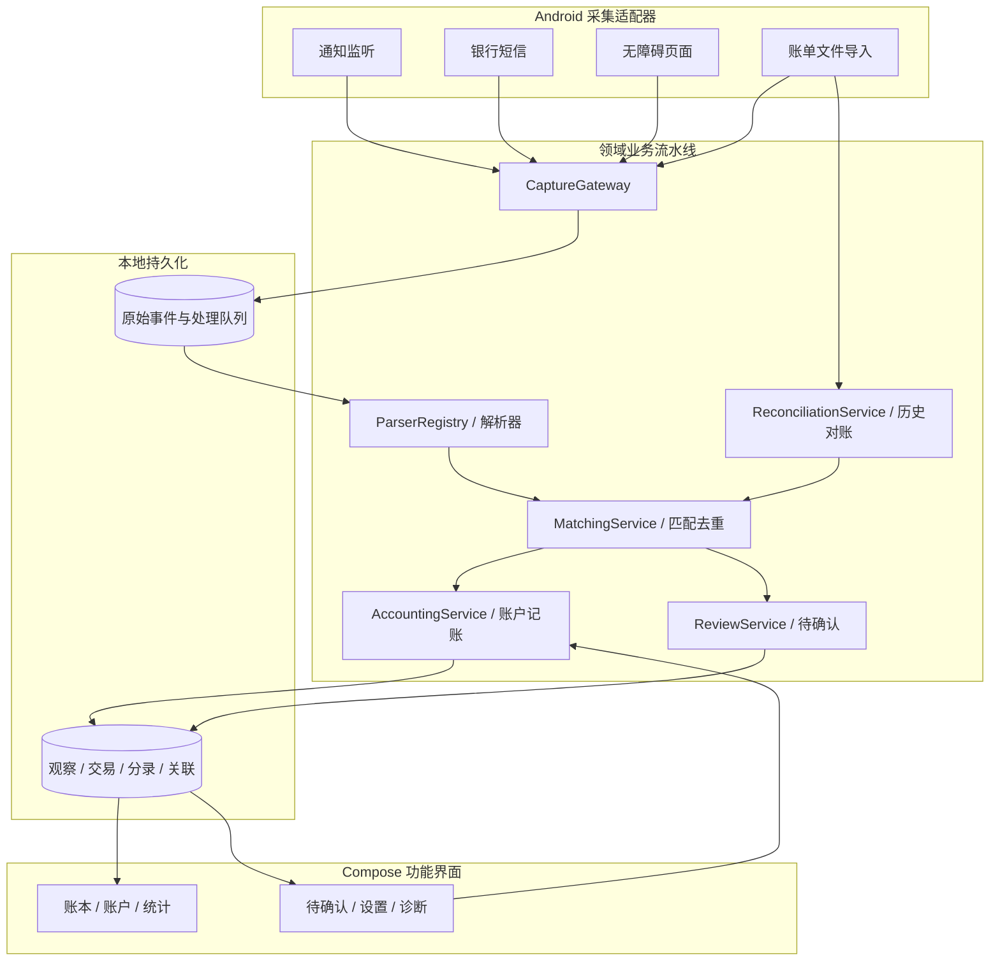
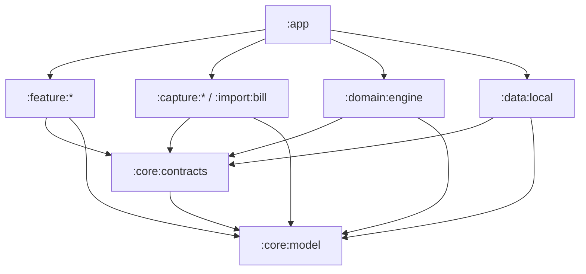
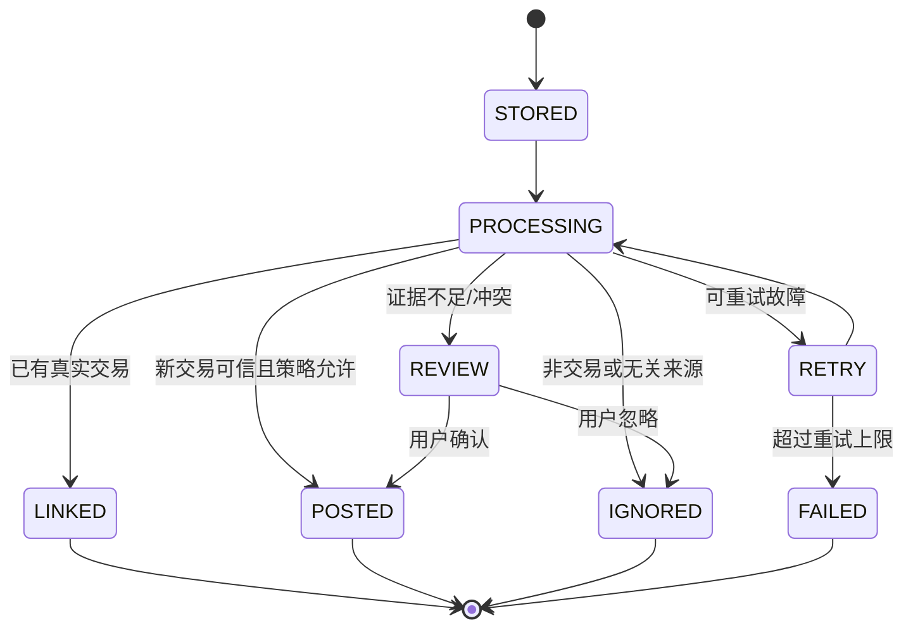

# OctopusCue — 架构设计与分阶段开发方案（v2.0）

> **文档状态**：拟实施 / 架构基线  
> **版本**：2.0  
> **日期**：2026-11-02  
> **项目**：OctopusCue（Android 个人自动记账 App）  
> **目标读者**：项目开发者，以及未来参与维护、测试或代码生成的协作者  
> **建议存放路径**：`docs/architecture-and-roadmap.md`

---

## 0. 执行摘要

OctopusCue 的目标是：**在 Android 手机上尽可能自动地发现收支交易，用可核验的证据建立准确账本，且所有金融数据默认保留在本机。**

采用以下组合架构：

| 关注点 | 选型 | 解决的问题 |
| --- | --- | --- |
| 工程组织 | **模块化单体（Modular Monolith）** | 各业务边界可独立编译、测试和迭代 |
| 依赖规则 | **Clean Architecture 思想 + Ports & Adapters** | 业务规则不直接绑定 Android、Room 或某个支付渠道 |
| 渠道扩展 | **编译期适配器/解析器注册表** | 增加银行、支付平台、账单格式时改动局部化 |
| 交易处理 | **本地可靠事件流水线（Room 持久化 + 可重试处理）** | 崩溃恢复、重复事件处理、可追溯和对账 |
| UI | **Compose + ViewModel + 单向数据流（UDF）** | 按页面隔离状态与交互 |
| 记账语义 | **交易观察 → 真实交易 → 平衡分录** | 正确处理消费、收入、内部转账、信用卡还款、退款 |
| 依赖注入 | **手动 AppGraph，必要时演进为 Hilt** | 首期实现简单，后续可替换 |
| 服务端 | **首期无后端、无需登录** | 降低运营、安全与维护复杂度 |

**两条硬规则：**

1. **采集 ≠ 交易**：一条通知、短信或页面快照只是证据；多条证据可能对应同一笔交易。
2. **识别 ≠ 入账**：解析器只做事实提取；只有账本业务服务可以正式记账，且必须可追溯、可撤销、可对账。

本文基于此前 v1.0 架构文档升级，并参考 [ControlECO 原仓库](https://github.com/ArrogHie/ControlECO) 的实际代码组织和采集经验。**借鉴机制，不照搬其单模块结构或大型全局协调器。**

---

## 1. 背景与范围

### 1.1 当前项目状态

已建立 IntelliJ IDEA 中的 Android 工程 `OctopusCue`，现有入口类似：

```text
app/src/main/java/com/example/octopuscue/
├── MainActivity.kt
├── OctopusCueApplication.kt
├── di/AppGraph.kt
└── ui/theme/
```

仓库根目录有 `capture/`、`core/`、`data/`、`domain/`、`feature/`、`import/` 等目录。**目录本身不是 Gradle 模块**；只有完成 `build.gradle.kts`、`settings.gradle.kts` 注册和插件配置后，才算可编译模块。

IDE 采用 **IntelliJ IDEA + Android 插件 + Android SDK**；源码使用 Kotlin，`src/main/java` 下放置 `.kt` 文件完全正常。

### 1.2 核心功能（首期）

- 手动记账、账户管理、分类、收支明细与基本统计。
- Android 通知监听：从微信、支付宝、选定银行 App 系统通知中提取交易证据。
- 基于真实样本的微信/支付宝交易解析（包括收款、付款、退款等）。
- 对同一交易的通知重复更新、不同来源证据进行识别和去重。
- 人工待确认、误记撤销、交易编辑；不确定时不强行自动入账。
- 用户主动导入微信、支付宝官方账单，补全漏记、核对历史数据。
- 本地数据持久化、数据库版本迁移、基本备份能力。

### 1.3 后续可选功能

- 银行短信接收（`RECEIVE_SMS` 权限可用时）。
- 无障碍页面采集（当前可访问的支付成功/收款结果页面）。
- 更多银行、云闪付、数字人民币等渠道适配。
- 预算、周期账单、债务/信用卡、资产统计、商户学习、智能分类。
- 加密本地备份、WebDAV 或自建同步、多设备客户端。

### 1.4 明确非目标

- 不使用微信、支付宝个人账户的非公开登录接口或绕过认证进行批量抓取。
- 不自动操作登录、付款、收款确认、转账、红包领取；不读取支付密码、验证码。
- 不假设微信/支付宝每次支付或收款都会发布含金额的 Android 通知。
- 不把无障碍能力等同于后台读取整个微信数据库；仅能获取授权后**当前实际可访问**的页面节点。
- 不在 MVP 中引入微服务、Kafka、全量 Event Sourcing、动态安装第三方代码插件或云端 AI。

---

## 2. 从 ControlECO 学什么、改什么

仓库考察基准：2026-11-02，默认分支 `main`；源码以后可能更新。

| 方面 | ControlECO 实际做法 | OctopusCue v2.0 决策 |
| --- | --- | --- |
| Gradle 结构 | `settings.gradle.kts` 只注册 `:app`；按包分功能 | **多个 Gradle 模块**，逐步启用 |
| 采集入口 | `CaptureCenter` 集中管理通知、短信、页面 | **CaptureGateway + Processor + 独立服务**，避免一个对象管理全部业务 |
| 页面识别 | `AppPageParser` + `PageParserRegistry` 静态注册 | **保留解析器策略模式**，在纯 Kotlin 业务层注册 |
| 通知/短信解析 | 基于包名、身份闸门、状态词、真实样本正则 | **保留严格来源和状态校验**，并将规则与采集器分离 |
| 去重 | `CaptureMerge`、`CrossChannelDedup`、`LogicalTransactions` 等 | **独立 MatchingService**，匹配决策可追溯、可单测 |
| 数据 | Room `TransactionEntity` 等，部分 UI/采集直接持有 DAO | **Repository 接口隔离**，Room 只存在基础设施模块 |
| UI | Compose，较集中的 `LedgerViewModel` | **按页面/功能拆 ViewModel**，避免超大 ViewModel |
| 实时性与完整性 | 通知/页面/短信 + 账单导入 | **同样采用混合采集**，把账单导入视为对账权威证据之一 |
| 页面兼容 | 包含特殊无障碍服务组件类名试验 | **不依赖伪装/特殊组件身份**，采用标准公开 API 和降级方案 |

源码参考：

- [ControlECO settings.gradle.kts](https://github.com/ArrogHie/ControlECO/blob/main/settings.gradle.kts)
- [CaptureCenter.kt](https://github.com/ArrogHie/ControlECO/blob/main/app/src/main/java/com/controleco/app/capture/CaptureCenter.kt)
- [PageParserRegistry.kt](https://github.com/ArrogHie/ControlECO/blob/main/app/src/main/java/com/controleco/app/capture/page/PageParserRegistry.kt)
- [CrossChannelDedup.kt](https://github.com/ArrogHie/ControlECO/blob/main/app/src/main/java/com/controleco/app/capture/CrossChannelDedup.kt)
- [自动记账捕获机制文档](https://github.com/ArrogHie/ControlECO/blob/main/docs/%E8%87%AA%E5%8A%A8%E8%AE%B0%E8%B4%A6%E6%8D%95%E8%8E%B7%E6%9C%BA%E5%88%B6.md)

> **许可证提示**：借鉴思路与自行实现不同于直接复制代码。复用 ControlECO 源文件前必须检查其 LICENSE 和依赖许可证，并评估分发义务。

---

## 3. 总体架构与关键边界

### 3.1 全局逻辑视图



**注意**：此图展示运行时数据流；Gradle 编译依赖方向见第 5 节。UI 的确认、修改需要通过用例接口触发，不应直接调用业务服务对象或 DAO。

### 3.2 四层职责

1. **采集适配层**：接触 Android 通知、短信、无障碍和文件 API；仅输出标准化证据。
2. **领域业务层**：识别事实、关联同一交易、分类、记账、对账；保持纯 Kotlin。
3. **持久化适配层**：Room、DAO、DataStore、事务、迁移及处理队列存储。
4. **表现层**：Compose、ViewModel、导航、用户确认与调试。

### 3.3 三层数据语义

**CaptureEvent（采集事件）**：看到什么，例如“微信支付收款 50 元”的一条通知。  
**TransactionObservation（交易观察）**：解析器推断什么，例如“成功资金流入 5,000 分，来源微信通知”。  
**Transaction（账本交易）**：系统确认发生了什么经济活动，例如“一笔收款 50 元，经分类属于借款归还或收入”。

**账本交易对应多条分录（LedgerPosting）**；不同采集事件也可能都关联到同一账本交易。

### 3.4 核心不变量

- 一份原始事件被重新处理多次，不会产生重复交易或重复分录。
- 两次真实同额消费不会仅因时间接近而被折叠成一笔。
- 账本正式交易与分录在**同一数据库事务**中写入，不能半成功。
- 每笔已过账的资金交易在同一币种下借贷总额相等（`sum(signedPostingAmount) == 0`）。
- 任何自动富化不能无条件覆盖用户手动确认、修改的字段。
- 收入方向（资金流入）并不自动等于收入性质（`INCOME`）。
- 退款与原消费建立关联，不误标成普通新收入。
- 采集器不直接调用交易表 DAO；UI 不直接调用 Room DAO。

---

## 4. 模块设计与职责

目标共 **12 个 Gradle 模块**，按里程碑逐步创建；模块内部用普通 Kotlin Package 分层，不把每个类拆为独立模块。

| Gradle 模块 | 类型 | 核心职责 | 非职责 | 启用阶段 |
| --- | --- | --- | --- | --- |
| `:app` | Android Application | 启动、Manifest 整合、导航宿主、`AppGraph` 组装 | 交易规则、SQL | M0 |
| `:core:model` | Kotlin/JVM | 领域值对象、事件、观察、交易、分录模型 | Android/Room/Compose | M0 |
| `:core:contracts` | Kotlin/JVM | 采集入口、存储、账本命令和查询端口 | 实际实现 | M0 |
| `:domain:engine` | Kotlin/JVM | 解析注册、匹配、记账校验、分类、对账、审查用例 | Android Service、DAO | M0 |
| `:data:local` | Android Library | Room、仓库实现、DataStore、迁移、事务和重试队列 | 支付平台业务正则 | M0 |
| `:feature:ledger` | Android Library | 手动记账、账户、流水、待确认、统计 UI | 直接写数据库 | M1 |
| `:feature:settings` | Android Library | 权限引导、采集开关、账户与隐私设置 | 通知读取逻辑 | M2 |
| `:capture:notification` | Android Library | 系统通知提取、白名单、折叠处理、通知实例识别 | 识别消费性质、去重入账 | M2 |
| `:import:bill` | Android Library | 文件选择、CSV/XLSX 解析、导入批次、交易行标准化 | 绕过匹配器直接入账 | M4 |
| `:capture:sms` | Android Library | 新到银行短信初筛与事件提交 | 读取全部历史短信 | M5 可选 |
| `:capture:accessibility` | Android Library | 授权范围页面快照、事件防抖、多窗口读取 | 自动点击/付款/识别最终经济性质 | M5 可选 |
| `:feature:debug` | Android Library | 采集状态、解析回放、匹配决策、诊断记录 | 常驻保存私人通知全文 | M5 可选 |

### 4.1 `:app` — 组合根（Composition Root）

**负责**：`OctopusCueApplication`、`MainActivity`、`di/AppGraph.kt`、主导航宿主、绑定端口到实现、应用生命周期恢复任务。系统注册的 Service 由其所在 Android Library 声明 Manifest，并由最终 App Manifest 合并。

`AppGraph` 初期手动装配；Service 由 Android 系统创建，**不能**要求 Android 通过自定义构造函数传依赖。可以让 `Application` 实现一个明确的 `CaptureGatewayProvider` 接口（由捕获模块/公共接口模块定义），服务通过 `applicationContext` 获取接口；未来可迁移到 Hilt EntryPoint。

### 4.2 `:core:model` — 纯业务数据

定义 `Money`、`SourceId`、`CaptureEvent`、`CapturePayload`、`TransactionObservation`、`Transaction`、`LedgerAccount`、`LedgerPosting`、`ReviewItem`、交易匹配证据等**与实现无关的模型**。

- 金额存 `Long` 的货币最小单位（人民币为分），绝不使用 `Double` 进行金额运算。
- 存储时间用 epoch milliseconds + 时区/来源时间元数据；显示时才根据时区格式化。
- `paymentChannel`（微信/支付宝）和 `fundingAccount`（微信零钱/银行账户）分开表示。
- 不包含 Room `@Entity`、`Context`、`AccessibilityNodeInfo`、Compose 的类型。

### 4.3 `:core:contracts` — 端口接口

提供 `CaptureGateway`、`EventStore`、`TransactionQueryPort`、`LedgerCommitPort`、`ReviewPort`、`SettingsPort`、`ProcessingScheduler` 等。接口参数使用 `core:model` 类型。

**重要边界**：业务层生成 `LedgerCommitCommand`，`data:local` 在一个 Room 事务内一次完成交易、分录、证据关联，避免业务层先写交易再分别写账户造成半完成状态。

### 4.4 `:domain:engine` — 业务核心

建议内部按包分工：

| 子包 | 主要类/接口 | 职责 |
| --- | --- | --- |
| `ingestion` | `TransactionProcessor` | 消费待处理事件、协调解析/匹配/入账 |
| `parser` | `TransactionParser`、`ParserRegistry` | 来源专用解析、结果校验 |
| `matching` | `MatchingService`、`MatchEvidence` | 实体身份与多渠道去重，生成可解释决策 |
| `accounting` | `AccountingService`、`PostingValidator` | 交易性质、平衡分录、账户变动校验 |
| `classification` | `CategoryClassifier` | 关键词、商户映射、人工偏好建议 |
| `reconciliation` | `ReconciliationService` | 官方账单与实时观察的对账、遗漏补全 |
| `review` | `ReviewService` | 待确认、人工确认/纠正/忽略与状态迁移 |

规则优先、可追溯：每个解析结果记录 `parserId`、`ruleId`、`ruleVersion`；不能只通过聊天内容中“消费 + 金额”推断已成功消费。

### 4.5 `:data:local` — 可靠存储与事务

- Room 数据库、DAO、数据库迁移、索引与事务。
- 端口实现（EventStore、LedgerCommitPort、交易查询、待确认查询）。
- DataStore 配置和应用内留样、脱敏、保留策略。
- 事件队列领取/释放、失败原因、重试次数、死信/人工复核状态。

不允许 Room Entity 穿透到 `domain:engine` 或 ViewModel。使用映射器将持久化实体转换成领域模型。

### 4.6 `:capture:notification` — 通知来源

- 通过 `NotificationListenerService` 在用户开启通知使用权后获取系统通知。
- 只处理用户选择的目标包名（例如微信 `com.tencent.mm`、支付宝 `com.eg.android.AlipayGphone` 和明确校验过的银行包名）。
- 采集 `EXTRA_TITLE` / `EXTRA_TEXT` / `EXTRA_BIG_TEXT` / `EXTRA_TEXT_LINES` 等存在的字段、通知实例 key 和发布时间。
- 折叠通知必要时检查同组子通知；同一通知更新只形成相同事件实例的再次观察。
- 尽快提交最小事件给 `CaptureGateway`；不在系统回调中执行数据库扫描/复杂匹配。

仅采集**Android 实际发布**的系统通知。微信内部服务消息不一定出现在 Android 通知栏，无法保证所有收付款实时采集。

### 4.7 `:capture:sms` — 可选银行短信

- 仅处理新到的银行动账短信，使用广播和银行发送方/签名白名单初筛。
- 短信权限受系统和分发策略限制；即使仅自用或侧载，也必须在目标手机上验证是否可授权。
- 模块不可用时，银行 App 通知和账单导入仍应正常工作。

### 4.8 `:capture:accessibility` — 可选页面证据

- 用户单独开启后，接收窗口状态/内容/窗口集合变化事件。
- 对授权包名的**当前可访问窗口**提取文本、控件 ID、层级/顺序，限制节点数和采样次数。
- 支持事件防抖和页面稳定性补采；输出不含 Android 节点引用的 `PageSnapshot`。
- 不模拟系统朗读服务组件身份，不依赖特殊类名；不执行手势、自动点击、登录、付款、红包领取。
- 对不可访问/空节点的页面明确记录降级，不触发虚假入账。

微信聊天页面里的历史“已收款”“已领取红包”不是新的交易结果页；页面解析必须使用结果页锚点、交易状态和邻域金额等组合证据。

### 4.9 `:import:bill` — 账单导入适配器

- 系统文件选择器读取用户主动选择的文件，优先支持微信、支付宝官方 CSV/XLSX；按真实文件样本补充编码、日期和 ZIP 支持。
- 导入器按表头/字段名识别格式，不依赖固定列下标；每行记录来源交易号、文件指纹和行号。
- 一个文件对应一个 `ImportBatch`，重复导入同一文件应幂等。
- 导入事件与实时观察统一进入对账和匹配流程；**不**绕过业务引擎直接向 `transactions` 插入。

### 4.10 `:feature:ledger` — 账本应用界面

分为 `home`、`transactions`、`accounts`、`review`、`statistics` 五个内部包；每个主要页面使用自己的 ViewModel，避免全局千行 ViewModel。

### 4.11 `:feature:settings` — 权限与偏好

提供通知授权、短信权限、无障碍授权、来源开关、自动入账策略、默认账户、备份与诊断设置。该模块只引导授权，不自行读取支付信息。

### 4.12 `:feature:debug` — 诊断能力

提供“事件已捕获 → 规则命中/拒绝 → 匹配原因 → 入账结果”的可追溯视图。默认隐藏敏感通知全文；脱敏样本回放应与生产业务逻辑共享同一套解析器。

---

## 5. 模块依赖关系与目录结构

### 5.1 编译依赖方向（**箭头表示 Gradle 依赖**）



约束：

1. `:core:model` 是最底层；不能引用 Android/Room/Compose 或其他项目功能模块。
2. `:core:contracts` 仅依赖 `:core:model` 和必要的纯 Kotlin 库。
3. `:domain:engine` 依赖 `core` 抽象，不依赖 Android、Room、UI 或实际采集器。
4. `:capture:*` / `:import:bill` 依赖 `core` 抽象，不依赖 `:data:local`、`:domain:engine` 实现。
5. `:feature:*` 依赖 `core` 抽象和需要的 UI 公共库，不依赖 DAO。
6. `:app` 是最外层组合根，可以同时依赖上述实现，并完成接口绑定。
7. 禁止循环依赖；新增能力优先新增适配器，不修改核心处理流程。

### 5.2 工程目录（目标态）

```text
OctopusCue/
├── app/
│   ├── src/main/java/com/example/octopuscue/
│   │   ├── OctopusCueApplication.kt
│   │   ├── MainActivity.kt
│   │   └── di/AppGraph.kt
│   ├── src/main/AndroidManifest.xml
│   ├── src/main/res/
│   └── build.gradle.kts
├── core/
│   ├── model/{build.gradle.kts,src/main/kotlin/...}
│   └── contracts/{build.gradle.kts,src/main/kotlin/...}
├── domain/
│   └── engine/
│       ├── build.gradle.kts
│       └── src/main/kotlin/.../{ingestion,parser,matching,accounting,classification,reconciliation,review}/
├── data/
│   └── local/{build.gradle.kts,src/main/java/.../{db,dao,entity,mapping,repository,settings}/}
├── capture/
│   ├── notification/{build.gradle.kts,src/main/...}
│   ├── sms/{build.gradle.kts,src/main/...}
│   └── accessibility/{build.gradle.kts,src/main/...}
├── import/
│   └── bill/{build.gradle.kts,src/main/...}
├── feature/
│   ├── ledger/{build.gradle.kts,src/main/...}
│   ├── settings/{build.gradle.kts,src/main/...}
│   └── debug/{build.gradle.kts,src/main/...}
├── docs/
│   ├── architecture-and-roadmap.md
│   ├── adr/
│   └── samples/                   # 仅脱敏测试样本
├── gradle/libs.versions.toml
├── settings.gradle.kts
├── build.gradle.kts
└── gradlew.bat
```

### 5.3 分阶段注册 Gradle 模块

**M0 最小基座**：

```kotlin
// settings.gradle.kts：保留模板原有的 pluginManagement 和 repositories 配置
include(":app")
include(":core:model", ":core:contracts")
include(":domain:engine", ":data:local")
```

随后逐阶段添加 `:feature:ledger`、`:feature:settings`、`:capture:notification`、`:import:bill` 等。

- `core` 和 `domain` 使用 Kotlin/JVM Library；Android Service、Room、Compose 所在模块使用 Android Library。
- 各模块各自有 `build.gradle.kts`；插件/依赖版本统一维护在 Version Catalog。
- 使用模板兼容的 Android Gradle Plugin、Kotlin、Compose Compiler、KSP 与 Room 版本；**不要无依据地混搭版本**。
- 采用 Gradle Wrapper，而不是依赖本机全局 Gradle。

---

## 6. 领域模型、接口契约与持久化

### 6.1 统一模型（概念示例）

```kotlin
enum class CaptureChannel { NOTIFICATION, SMS, ACCESSIBILITY, BILL_IMPORT }
enum class MovementDirection { INFLOW, OUTFLOW }
enum class ObservedStatus { SUCCESS, PENDING, FAILED, UNKNOWN }

data class CaptureEvent(
    val id: String,
    val channel: CaptureChannel,
    val provider: String,
    val instanceKey: String?,
    val capturedAtEpochMs: Long,
    val sourceTimeEpochMs: Long?,
    val payload: CapturePayload
)

sealed interface CapturePayload {
    data class Notification(val packageName: String, val title: String, val text: String) : CapturePayload
    data class Sms(val sender: String, val text: String) : CapturePayload
    data class Page(val packageName: String, val textLines: List<String>) : CapturePayload
    data class BillRow(val provider: String, val fields: Map<String, String>) : CapturePayload
}

data class TransactionObservation(
    val id: String,
    val eventId: String,
    val amountMinor: Long?,
    val currency: String,
    val direction: MovementDirection?,
    val status: ObservedStatus,
    val providerTransactionId: String?,
    val counterparty: String?,
    val fundingAccountHint: String?,
    val occurredAtEpochMs: Long?,
    val parserId: String,
    val ruleVersion: Int
)
```

> 以上为接口形态示例，不是可直接复制到一个文件编译的完整源代码。正式实现应增加参数校验、异常结果类型、有效载荷长度上限和敏感字段保留策略。

### 6.2 可插拔解析接口

```kotlin
interface TransactionParser {
    val id: String
    fun supports(event: CaptureEvent): Boolean
    fun parse(event: CaptureEvent): ParseResult
}

sealed interface ParseResult {
    data class Recognized(val observations: List<TransactionObservation>) : ParseResult
    data class NeedsReview(val reason: String) : ParseResult
    data class Ignored(val reason: String) : ParseResult
}

class ParserRegistry(private val parsers: List<TransactionParser>) {
    fun parserFor(event: CaptureEvent): TransactionParser? =
        parsers.firstOrNull { it.supports(event) }
}
```

首期在 `AppGraph` 中静态注册 `WeChatNotificationParser`、`AlipayNotificationParser`、`BankNotificationParser`。后续按真实事件增加解析器。一个系统通知可能包含多条明细，故 `Recognized` 支持多个 Observation。

### 6.3 端口契约

```kotlin
interface CaptureGateway {
    // 表示事件已被安全接收/持久化，不代表交易已入账
    suspend fun accept(event: CaptureEvent): CaptureAcceptance
}

interface EventStore {
    suspend fun insertIfAbsent(event: CaptureEvent): Boolean
    suspend fun claimPending(limit: Int): List<CaptureEvent>
    suspend fun finish(eventId: String, outcome: EventOutcome)
}

interface LedgerCommitPort {
    // data:local 在单个 Room 事务中写交易、分录和证据关联
    suspend fun commit(command: LedgerCommitCommand): LedgerCommitResult
}

interface TransactionQueryPort {
    fun observeLedger(): kotlinx.coroutines.flow.Flow<List<Transaction>>
}
```

`EventStore` 的 `claimPending` 在正式实现中应支持原子领取、处理中租约/超时恢复、尝试次数以及并发冲突控制；上述示例只是说明接口边界。

### 6.4 数据库表建议

| 表 | 必要字段/索引 | 用途 |
| --- | --- | --- |
| `capture_events` | `id`, `channel`, `provider`, `instance_key`, `payload`, `created_at`, `state`, `retry_count` | 保留必要原始证据和可靠处理队列 |
| `observations` | `id`, `event_id`, `amount_minor`, `direction`, `status`, `provider_tx_id`, `parser_version` | 标准化观察结果 |
| `transactions` | `id`, `kind`, `status`, `occurred_at`, `currency`, `merchant`, `category_id`, `user_edit_mask` | 真实经济活动 |
| `observation_links` | `observation_id`, `transaction_id`, `match_reason`, `confidence` | 多来源证据支持一笔交易 |
| `ledger_accounts` | `id`, `name`, `type`, `currency`, `masked_identifier`, `active` | 资产、负债、费用、收入及权益科目 |
| `ledger_postings` | `id`, `transaction_id`, `account_id`, `signed_amount_minor` | 平衡借贷分录 |
| `categories` | `id`, `type`, `name`, `parent_id` | 消费/收入分类与规则 |
| `review_items` | `id`, `observation_id`, `reason`, `state`, `created_at` | 待确认与人工纠正 |
| `import_batches` | `id`, `provider`, `file_hash`, `imported_at`, `state` | 导入历史、来源与重复文件检测 |
| `match_decisions` | `id`, `observation_id`, `candidate_id`, `decision`, `reason_codes` | 可解释匹配与误合并诊断 |

关键一致性和索引：

- 优先使用平台真实 `providerTransactionId`（限定来源命名空间）做强身份关联；不能假设所有来源都有交易号。
- `capture_events` 按**来源 + 稳定实例标识**设合理的幂等约束；通知更新与新交易须区分，不把金额+分钟作为唯一索引。
- `observations(event_id, parser_id, rule_version, observation_ordinal)` 可用于同一原始事件的重放幂等。
- 所有交易写入和关联/分录更新必须使用 Room 事务及数据库唯一约束兜底。
- 后续变更使用数据库 Migration，保留并测试历史 schema。
- 账单行以来源交易号为优先身份、文件指纹+行位置为退化身份，跨文件重复交易仍走正式匹配流程。

### 6.5 从一开始保留平衡记账能力

建议以**借方为正、贷方为负**（`signed_amount_minor`）保存分录，且每笔交易同币种内总和必须为 0。

| 场景 | 借方（+） | 贷方（-） | 消费统计 |
| --- | --- | --- | --- |
| 微信零钱买午餐 30 元 | 餐饮费用 `+3000` | 微信零钱资产 `-3000` | 消费 30 元 |
| 工资入银行卡 5,000 元 | 银行资产 `+500000` | 工资收入 `-500000` | 收入 5,000 元 |
| 银行卡充值微信零钱 200 元 | 微信零钱资产 `+20000` | 银行资产 `-20000` | 0 元（内部转账） |
| 信用卡购买商品 100 元 | 购物费用 `+10000` | 信用卡负债 `-10000` | 消费 100 元 |
| 银行卡归还信用卡 100 元 | 信用卡负债 `+10000` | 银行资产 `-10000` | 0 元（清偿负债） |
| 消费退款 10 元 | 收款资产 `+1000` | 原费用冲减 `-1000` | 冲减原消费 10 元 |

若收款来源性质未知，先存入待确认，不强行记入“收入”；可在用户指定后正式生成分录。初期界面可以只显示简单的收/支/转账，底层保留未来扩展的会计语义。

---

## 7. 可靠处理流水线与状态机

### 7.1 事件处理流程



**事件处理状态 ≠ 交易过账状态**。例如事件 `LINKED` 表示并入既有交易；既有交易可以已经过账。不能把重复事件简单删除，否则无法追溯合并依据。

### 7.2 可靠性设计

- 系统通知回调只执行有界的文本提取与提交；后台持久化成功前不宣称交易已记账。
- 通知回调本身不保证永不丢失：进程异常退出、ROM 杀后台或来源未发通知时仍可能漏采。历史账单对账是补偿手段。
- **先原始事件持久化，后解析/匹配/写账**；Worker 在应用启动或计划任务中补处理未完成事件。
- WorkManager 用于“可以延迟的补处理和清理”，不能保证支付通知即时到达，也不替代 `NotificationListenerService`。
- 通过事件幂等键、数据库唯一约束、提交事务、重试/租约避免重复入账和半完成状态。
- 建议同一账本的过账操作按串行或数据库事务隔离执行；并行解析可以保留，但提交前重新验证匹配条件。
- 模型和解析规则必须有版本号，重放旧事件时遵守用户修改保护，不直接覆盖正式分录。

### 7.3 统一来源优先级

对**同一笔**交易，信息可信度通常为：官方账单中真实交易号/成功状态 > 结果详情页明确字段 > 完整系统通知 > 仅方向/金额的短信或摘要。

但这是**字段级、证据级优先级**，不是笼统地覆盖整条记录。账单自身也可能有格式异常或迟到状态；金额冲突必须转人工复核。用户已手动修改的字段优先受保护。

---

## 8. 微信、支付宝、银行采集方案

### 8.1 微信收款的三种路径

| 场景 | 首选来源 | 处理规则 | 自动化边界 |
| --- | --- | --- | --- |
| 个人二维码收款 | 微信支付系统通知 | 先验证支付通知身份，再识别“收款成功/到账”与金额 | 微信没发含金额的系统通知则无法实时采集 |
| 好友转账 | 成功到账通知；主动查看时的收款结果页 | **转账消息/待领取不等于到账**，需成功状态 | 没有成功证据时待确认/文件补账 |
| 微信红包 | 官方账单；可选领取页提示 | 未知领取金额不自动入账 | 红包通知/历史聊天不可靠 |

微信 `com.tencent.mm` 与聊天信息共用包名。**仅凭“金额 + 消费/收款”绝不能记账**，必须先通过来源身份闸门和成功状态规则；来源规则依据脱敏真机样本建立，防营销推送误判。

### 8.2 微信/支付宝付款

- 通知层以真实“支付成功/已支付/已扣费”等格式匹配，必须排除失败、取消、待付款、营销红包/优惠券。
- Android 页面可访问时，以交易结果页标题、状态、金额邻域、商户、交易时间/订单号补全信息。
- 支付渠道和最终扣款账户分开保存：微信付款可能扣微信零钱、银行卡或其他资金工具。

### 8.3 银行卡

- 第一优先银行 App 动账推送与已明确可采集的短信 App 通知。
- `:capture:sms` 在目标设备授权可用时作为增强，严格筛选银行发送方与文本签名。
- 同笔“微信支付成功 + 银行卡扣费”的两条证据可合并，但需要明确匹配证据；**仅金额相同且时间接近默认进入疑似重复**，不无条件自动合并。
- 银行收入与微信收款之间不应按同金额自动合并，可能是两笔独立资金流入。

### 8.4 历史账单对账

用户主动导出并选择账单；导入模块识别文件格式、记录来源交易号并逐行产生事件。正式对账根据交易号、时间、金额、方向、状态及对方信息，对实时记录进行补全、冲突提示或新增漏记记录。

**严格区分对账与直接入账**：有官方账单也不意味着每一行都该计作消费，如充值、提现、还款、内部转账应按资金性质处理。

---

## 9. 交易身份、去重和资金关联

### 9.1 分层匹配策略

1. **同源精确身份**：平台交易单号、通知实例更新、相同文件来源行或同一页面流程 ID。
2. **跨来源强证据**：金额/方向/时间吻合，且支付渠道、银行卡尾号、商户、交易状态等能相互印证。
3. **候选匹配**：只有金额和时间接近，或多个候选都可能对应同一笔 → 标记为 `POSSIBLE_DUPLICATE`，需要确认。
4. **冲突**：来源金额、交易状态或资金账户相矛盾 → 保留观察与冲突证据，不覆盖已确认交易。

去重判断应返回**可解释结果**：`MATCH_EXISTING`、`CREATE_NEW`、`REVIEW_REQUIRED`、`IGNORE_DUPLICATE_EVENT`，并携带原因码和关联证据。

### 9.2 特别需要防止的错误

- 10 秒内连续两次消费 10 元，不能自动合成一笔。
- 两个通知恰好复用标题和正文，但实例 ID/实际交易单号不同，不能只凭文本合并。
- 微信付款 100 元和银行扣款 100 元，正确目标是一次消费及其实际扣款账户。
- 银行转微信零钱 500 元属于内部转账，不算支出 500 + 收入 500。
- 信用卡支付时已经发生消费，后续信用卡还款不是新消费。
- 收到红包通知但尚未领取，不能计入到账；退款应关联原交易。
- 人工修改金额/账户后，新增证据不能无条件覆盖。

### 9.3 待确认策略

建议三个业务决策等级：

| 证据等级 | 行为 | 示例 |
| --- | --- | --- |
| 明确且唯一 | 可按设置自动入账 | 官方账单交易号明确、支付成功、账户已知 |
| 大体明确但缺字段 | 预填待确认 | 成功收款金额已知，但账户或收款性质不确定 |
| 冲突/歧义 | 拒绝自动记账，展示原因 | 同额两笔候选、金额不一致、未知交易状态 |

用户可以在“待确认”中：确认并分类、修改金额、指定账户、忽略、手动关联既有交易、撤销或重新解析。

---

## 10. UI、配置和扩展能力

### 10.1 UI 组织

```text
feature:ledger/
├── home/              # 今日/月度概览
├── transactions/      # 账单、搜索、编辑、手动记账
├── accounts/          # 账户与余额
├── review/            # 待确认、疑似重复、退款匹配
└── statistics/        # 简单收支分类与趋势
```

每个页面配置独立 `ViewModel`，以 `StateFlow<UiState>` 暴露数据、通过显式 `Action/Intent` 触发用例。导航事件由 UI 层处理，业务层不依赖页面路由。

### 10.2 后续功能如何接入

| 新增功能 | 优先扩展位置 | 不应修改 |
| --- | --- | --- |
| 新银行通知 | `domain:engine/parser` 新解析器 + 来源白名单 | 正式账本 DAO 结构（通常） |
| 新账单文件格式 | `import:bill` 新 Reader/Adapter | 通知采集服务 |
| AI 智能分类 | 新 `CategoryClassifier` 实现 | 交易匹配/入账原子性 |
| 预算提醒 | `feature:budget` + `domain:budget`（足够复杂时） | 原始事件采集器 |
| WebDAV 同步 | `sync:webdav` + 同步端口（以后新增） | 平台解析器 |
| 资产负债看板 | UI 统计功能 + LedgerPosting 查询 | 通知监听逻辑 |
| iOS / Web 客户端 | 共享业务契约 / 数据协议（后期再评估） | Android 采集权限实现 |

首期不需要用户可安装的外部 APK 插件。所谓“插件式”是指**编译期新增一项实现，并在 `AppGraph`/注册表中装配**。

---

## 11. 安全、权限与隐私

| 功能 | 所需能力 | 默认策略 |
| --- | --- | --- |
| 微信/支付宝/银行系统通知 | `NotificationListenerService` 与用户开启通知使用权 | 用户明确授权，来源白名单 |
| 新到银行短信 | `RECEIVE_SMS`，受 Android 与分发政策限制 | 默认关闭、真机验证后启用 |
| 当前页面读取 | `AccessibilityService`，用户单独授权 | 默认关闭，只读允许的支付 App |
| App 自身提醒 | Android 13+ 需要 `POST_NOTIFICATIONS` | 仅在需要横幅提醒时申请 |
| 用户账单文件 | `ACTION_OPEN_DOCUMENT` 等系统文件选择器 | 用户主动选择，不申请全存储访问 |
| 本地备份 | SAF + 用户提供备份位置 | 加密、显式导出 |

**最低安全要求：**

1. 不获取支付密码、验证码、不写自动付款脚本；无障碍不申请不必要手势或截图能力。
2. `M0–M4` 可不申请 `INTERNET`，保持离线；将来更新检查或同步应有明确数据流和开关。
3. 金融敏感数据加密方案单独设计：Room 默认**不提供数据库文件整体加密**。可以选择基于 Android Keystore 管理密钥的字段加密或兼容 Room 的加密数据库方案；记录选择和密钥恢复策略。
4. 显式配置 Android 备份规则，避免应用私有账本意外进入云备份；必要时关闭备份或仅允许用户主动加密导出。
5. 原始日志/页面快照最小化保存：仅保留交易必要字段，设置短期保留和清除能力；正式构建不输出通知原文到 Logcat。
6. 测试样本必须脱敏，不能把真实交易、联系人信息、卡号或验证码提交 Git。
7. 不将第三方 App 的内部行为、特殊无障碍组件命名、后台保活技巧视为稳定公开 API。
8. 若未来公开发布，应另行检查平台政策、短信与无障碍权限要求、个人信息保护和用户授权文案。

---

## 12. 测试架构与质量门禁

### 12.1 单元测试（重点）

| 组件 | 必测场景 |
| --- | --- |
| 解析器 | 微信收款/付款、营销通知、退款、失败、未领取转账、红包、缺金额 |
| 页面解析 | 成功页、聊天页历史转账、多个金额歧义、页面重复渲染、空节点 |
| 匹配器 | 相同通知重发、同额连续两笔、跨渠道配对、候选不唯一、人工修改保护 |
| AccountingService | 收入、消费、账户间转账、信用卡消费/还款、退款、借贷分录平衡 |
| 文件导入 | 文件重复导入、行顺序变化、CSV 编码、XLSX 日期、异常行、重复交易号 |
| 事件处理器 | 失败重试、进程重启恢复、并发入账、重复调用幂等 |

### 12.2 数据库/集成测试

- Room 唯一约束、外键、Migration、事务回滚与一笔交易多分录一致性。
- 采集事件从 `STORED` 到 `POSTED/REVIEW/LINKED` 的端到端数据流。
- 官方账单导入与已有实时账目对账，不覆盖用户编辑。

### 12.3 真机测试（无法由单元测试替代）

- 微信：扫码收款、好友转账（未领取/已领取）、付款、退款、红包。
- 支付宝：余额支付、银行卡支付、退款、转账、收钱码。
- 银行：App 推送及可获得的短信，银行卡尾号遮罩、到账延迟。
- 系统：锁屏、通知折叠、服务重新绑定、后台清理、升级后授权状态。

指标按**已人工核验的测试交易**统计：事件捕获率、解析准确率、自动入账正确率、误合并率、对账覆盖率。不能仅用“解析成功的通知百分比”代替真实交易覆盖率。

### 12.4 CI / 质量门禁

在每个里程碑至少执行：

```powershell
.\gradlew.bat :app:assembleDebug
.\gradlew.bat test
```

实际可运行的测试任务以各模块插件生成的 Gradle task 为准；Android 仪器测试要有模拟器或真机。新增解析规则必须附带脱敏测试样本和回归测试。

---

## 13. 分阶段开发计划（推荐执行顺序）

> 只定义完成条件，不做未经验证的日程承诺。每个阶段结束时保持可编译、可运行的 Android App。

### M0 — 工程基座与模块依赖

**创建/启用：** `:app`、`:core:model`、`:core:contracts`、`:domain:engine`、`:data:local`。

**任务：**

- 调整 `settings.gradle.kts`，每个 Gradle 模块拥有独立 `build.gradle.kts`。
- 在 `core:model` 定义 `Money`、`LedgerAccount`、`Transaction`、`LedgerPosting` 等基础模型。
- 在 `core:contracts` 定义账本查询/提交端口和 `CaptureGateway`。
- 在 `data:local` 建 Room 初始 schema 和 Repository 映射。
- 在 `app/di/AppGraph.kt` 手动组装数据库、业务服务和端口。
- 在 `app` 暂放简单的开发验证页面，避免因未建立 feature 模块而阻断编译。

**验收：** `:app:assembleDebug` 成功；能够提交并查询一笔测试交易，且分录平衡；纯业务单元测试能独立执行。

### M1 — 可用账本（先不做自动采集）

**新增：** `:feature:ledger`。

**任务：** 手动记账、账户和分类、交易列表、编辑/撤销、基本统计、ViewModel 与 Repository 对接。

**验收：** 手机真机添加交易后退出/重启仍可读取；消费、收入、内部转账、信用卡还款统计正确；没有 UI 直接调用 DAO。

### M2 — 微信/支付宝通知采集闭环

**新增：** `:capture:notification`、`:feature:settings`。

**任务：** 通知访问权限引导、服务与包名白名单、原始事件持久化、微信/支付宝通知解析器、待确认列表、入账策略开关。

**验收：** 真机产生完整支付/收款通知后可以识别成待确认或可信交易；缺金额或未成功事件不自动入账；通知重复更新不重复创建交易。

### M3 — 多渠道匹配、平衡记账与恢复能力

**重点增强：** `:domain:engine/matching`、`accounting`、`:data:local`。

**任务：** 同源身份去重、银行 App 推送解析、跨渠道匹配、候选歧义处理、可靠队列和重试、字段级用户编辑保护。

**验收：** 微信绑定银行卡付款不会被重复计消费；连续两次同金额交易不丢单；故意让处理中断后再次启动不会重复记账；退款和还款统计正确。

### M4 — 微信/支付宝账单导入与历史对账

**新增：** `:import:bill`。

**任务：** SAF 选文件、CSV/XLSX 解析适配器、批次记录、历史账单对账、漏记补全、冲突确认。

**验收：** 同一文件导入两次不重复成单；实时通知已经记录的交易被导入账单匹配后不重复；异常/未知交易不静默误记。

### M5 — 可选采集增强与调试

**可选新增：** `:capture:sms`、`:capture:accessibility`、`:feature:debug`。

**任务：** 银行短信权限验证、页面快照和专属解析器、权限/服务健康诊断、脱敏规则回放。

**验收：** 可关闭任何增强通道而不影响其他功能；微信聊天历史不会被当成新增收款；解析器异常不会令采集服务整体失效。

### M6 — 未来扩展（按需立项）

依次评估预算与订阅、商户学习、本地 AI 分类、完整备份与恢复、WebDAV、多设备同步。应分别设计小型 ADR，不提前引入空壳模块。

---

## 14. 第一轮落地任务清单（你现在可以直接照做）

你目前已经有 `app` 和几组空的顶层目录。下一步不必同时建立所有 12 个模块。

### 14.1 优先创建的五个模块

```text
:app
:core:model
:core:contracts
:domain:engine
:data:local
```

### 14.2 推荐创建顺序

1. **确认 `app` 可编译**，`MainActivity.kt` 与 `OctopusCueApplication.kt` 位置、Manifest 注册正确。
2. 创建 `core/model` 为 Kotlin/JVM Library；先实现 `Money`、交易种类、账户模型。
3. 创建 `core/contracts`，只声明接口与必要的命令/结果类型。
4. 创建 `domain/engine`，实现 `AccountingService` 和基础过账校验；先用内存假的 Repository 单测。
5. 创建 `data/local`，配置 Room、实体/DAO、迁移和端口实现。
6. 在 `app/di/AppGraph.kt` 把 `LedgerCommitPort` / `TransactionQueryPort` 等绑定到业务服务。
7. 用一个临时 Compose 按钮提交“微信零钱消费 1.00 元”，再读出真实账本与两条平衡分录。

### 14.3 第一项验收用例

```text
输入：微信零钱消费 1.00 元，分类：餐饮

期望：
- Transaction：1 笔，状态 POSTED
- LedgerPosting：餐饮费用 +100 分
- LedgerPosting：微信零钱资产 -100 分
- 两条分录合计 0
- 重复提交同一命令不会生成第二笔交易
- 重启 App 账本与账户变动仍正确
```

通过这一例子后再启动通知监听开发，能避免“采集已完成，但账本模型不稳定”的返工。

---

## 15. 架构决策记录（ADR）

| ID | 决策 | 原因 | 重新评估触发条件 |
| --- | --- | --- | --- |
| ADR-001 | 多模块单体，而非微服务 | 单机 Android、个人维护 | 实际出现共享后端/多人服务化需求 |
| ADR-002 | 核心业务纯 Kotlin | 快速单测、隔离 Android API | Android 特有逻辑必须渗入领域层时重新审查 |
| ADR-003 | 采集事件、观察、真实交易分离 | 多来源证据与交易一对多关系 | 无需撤销；作为长期不变量 |
| ADR-004 | 本地可靠队列 + Room 事务 | 防止重复入账、断点恢复 | 未来多设备同步需补分布式一致性 |
| ADR-005 | 编译期解析器注册，不做动态插件 | 足以支持新平台、实现轻量 | 需要运行时下载第三方扩展时 |
| ADR-006 | 以平衡分录承载资金变化 | 防止重复消费统计，支持信用卡/转账 | 无需撤销；用户层仍可保持简单 |
| ADR-007 | 模糊匹配保留待确认 | 误合并意味着隐蔽漏记 | 真实样本证明某规则可靠后才可放宽 |
| ADR-008 | 无障碍与 SMS 都是可选 | 权限限制和 ROM 兼容性 | 特定机型有可靠的额外采集来源 |
| ADR-009 | 不依赖私有微信/支付宝 API | 稳定性、权限、隐私和合规 | 合法获得正式平台接口访问资格 |
| ADR-010 | 手动 AppGraph 起步 | 单人项目最小复杂度 | 模块注入和测试样板显著增长时改用 Hilt |

---

## 16. 完成定义（Definition of Done）

每个功能/模块的 PR 或提交至少满足：

- [ ] 功能职责与所属模块一致，不出现新的反向/循环依赖。
- [ ] 编译通过，已有单元测试通过。
- [ ] 新增解析规则有至少一个脱敏真实样本与回归测试。
- [ ] 写入交易有幂等与事务保护，不会产生不平衡分录。
- [ ] 用户已编辑字段的保护规则得到覆盖。
- [ ] 能解释未识别、待确认、合并和自动入账的原因。
- [ ] 敏感日志、权限及保留策略已检查。
- [ ] 更新文档：模块职责变更、schema migration、ADR（重大决策时）。

---

## 17. 最终实施建议

**不要将完整项目预先拆成几十个模块。** 当前先落地 5 个核心 Gradle 模块和可用的手动记账闭环；随着真实功能到来逐个接入通知、导入和可选采集。核心 API 稳定后再拆更细的 `domain:accounting`、`domain:budget`、`sync:webdav`。

OctopusCue v2.0 的长期稳定边界应是：

> **可替换的证据采集器 → 可测试的纯 Kotlin 交易引擎 → 有事务与幂等保障的本地账本 → 可扩展的 Compose 功能界面。**

这比单纯模仿 ControlECO 的代码目录更适合持续增加 AI、预算、资产管理和同步功能，也比一开始直接采用全量 Clean Architecture 框架或微服务更符合个人项目的成本结构。
